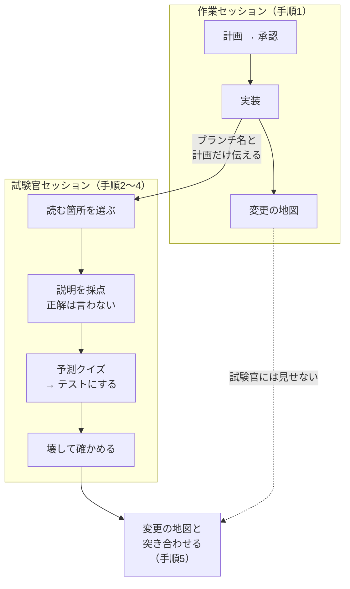

# dot-claude

Claude Code に任せたコードを、**全部読まずに自分で説明できる**ようになるための設定です。
コードを書いた AI とは別のセッションの AI が「試験官」になり、あなたの理解を採点します。

作成・管理：[cookkawasaki](https://github.com/cookkawasaki)

はじめて入れる人は、[docs/install.md](docs/install.md) を読んでください。

## 使い方



1. **作業セッション**で計画を承認し、実装させる。最後に出る「変更の地図」（[用語](#用語)）は、PR の説明に貼るかメモしておく
2. 変更をコミットしておく。Cloud の場合は push もする。そのうえで、同じリポジトリで**新しいセッション**を開く（別のウィンドウか、閉じてから開き直す）
3. 「理解度レビューをして」と頼む。「説明を採点して」「予測クイズを出して」でも始まる。聞かれたら、変更のあるブランチ名・取り込む先のブランチ（ふつうは main）・計画を答える
4. 試験官が選んだ箇所だけ読む → 何も見ずに説明を書く → 採点 → 予測クイズ → 壊して確かめる
5. 最後に、手順1の「変更の地図」と突き合わせる。試験官が選んだ箇所と食い違う所が、いちばん見落としやすい
6. 残すことにしたテストは、作業セッションに戻してコミットする（試験官はコミットしない）

### 例：説明を採点してもらう

```
あなた： 5回失敗すると15分ロックする。失敗はユーザーIDごとに数える。ロック中は401を返す。

試験官： ○ 1文目
         △ 2文目 → rate_limit.mjs の20〜24行目も見てください
         ✕ 3文目 → login.mjs の3行目で返している値を確かめてください
         抜け  → ログインに成功したとき、ストアに繋がらないとき
```

正解は教えず、見るべき行だけを指します。

### なぜ別のセッションなのか

コードを書いた AI に採点させると、書いたときの見落としを採点でも見落とすからです。試験官には差分と計画だけを渡し、書いた AI の説明は最後まで見せません。

## 入れると何が変わるか

- Claude Code がコードを書く前に、毎回計画を出して止まります。「OK」「ここを変えて」など普通に返事をすれば、それが承認です
- タイポや文言の修正など、設計判断を含まない数行の修正では計画を省略します。計画を飛ばしてほしいときは「計画は省略して」と伝えてください
- 設計判断（エラー処理・データ構造など）の手前で、選択肢と理由を示して質問してきます
- テストを先に書きます。依存の追加、PR の作成・マージ、main への push の前には確認を求めます
- 作業の最後に「変更の地図」を出します

## 入れ方

このリポジトリを **fork**（自分のアカウントにコピー）してから、Claude Code が動いている場所（自分の PC か Cloud か）に合わせて [docs/install.md](docs/install.md) の手順を行ってください。入ったかの確認と、更新のしかたも書いてあります。

## 中身

| ファイル | 役割 |
|---|---|
| [`CLAUDE.md`](CLAUDE.md) | コードを書かせる側のルール。内容は上の「入れると何が変わるか」のとおり |
| [`skills/comprehension-review/SKILL.md`](skills/comprehension-review/SKILL.md) | 試験官スキルの手順書。試験官が何をどの順でするかの詳細 |
| [`setup/cloud-setup.sh`](setup/cloud-setup.sh) | Cloud で使う人向けのセットアップスクリプト |
| [`docs/install.md`](docs/install.md) | 入れ方の詳しい手順（fork・A・B・確認・更新） |

## 注意

- 公開リポジトリです。会社のコードや社名を含む例はコミットしないでください（fork したコピーも公開になります）
- 作業中のリポジトリの `CLAUDE.md` と矛盾する場合は、リポジトリ側が優先されます

## 用語

| 用語 | 意味 |
|---|---|
| CLAUDE.md | Claude Code がセッションの最初に毎回読む指示書。`~/.claude/` に置くと、すべてのプロジェクトに効く |
| スキル | 特定の頼みごとをしたときだけ読み込まれる手順書 |
| 変更の地図 | 作業の最後に出させる変更の要約。ファイル別の要約、処理の流れ、判断の理由、検証結果、確認していないこと、読むべき箇所の6項目 |
| アサーション | テストの中で「こうなるはず」を確かめる行（`assert` や `expect` など） |
| 予測クイズ | コードを動かす前に結果を予想し、その予想をテストの期待値にして答え合わせをすること |
| 壊して確かめる | わざと1か所だけコードを変え、テストがそれに気づくかを見ること |

## 質問・改善案

[Issues](https://github.com/cookkawasaki/dot-claude/issues) に書いてください。

## ライセンス

[MIT](LICENSE)。著作権表示を残せば、fork・改変・仕事での利用も自由です。

## 参考

- [Comprehension debt](https://addyosmani.com/blog/comprehension-debt/)（Addy Osmani）：AI が書いたコードを誰も理解していない状態の問題
- [Not all AI-assisted programming is vibe coding](https://simonwillison.net/2025/Mar/19/vibe-coding/)（Simon Willison）：説明できないコードはコミットしない、という基準
- [How AI assistance impacts the formation of coding skills](https://www.anthropic.com/research/AI-assistance-coding-skills)（Anthropic）：AI に質問しながら使うと理解が保たれる、という研究
